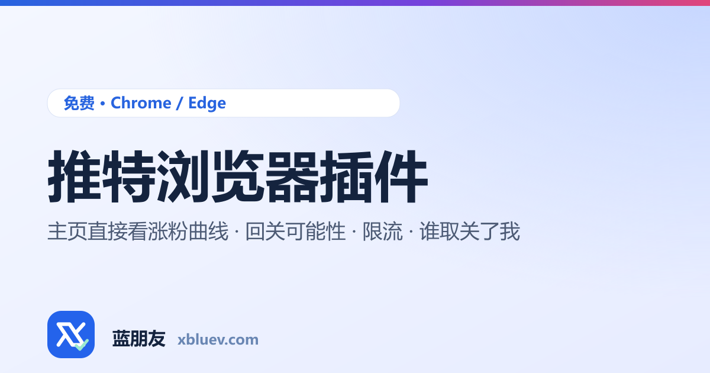
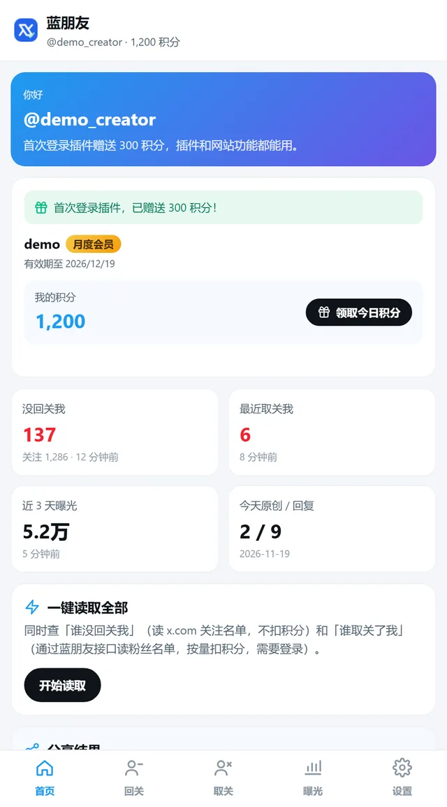
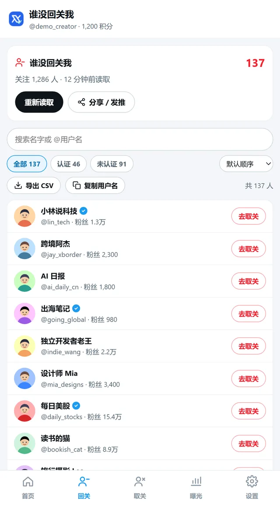
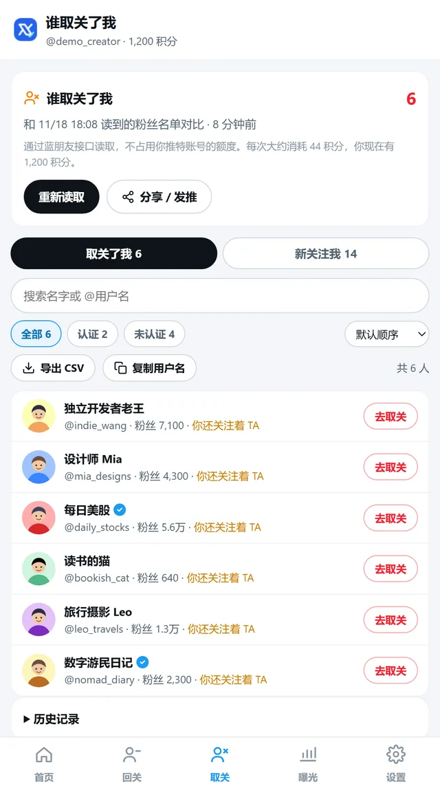
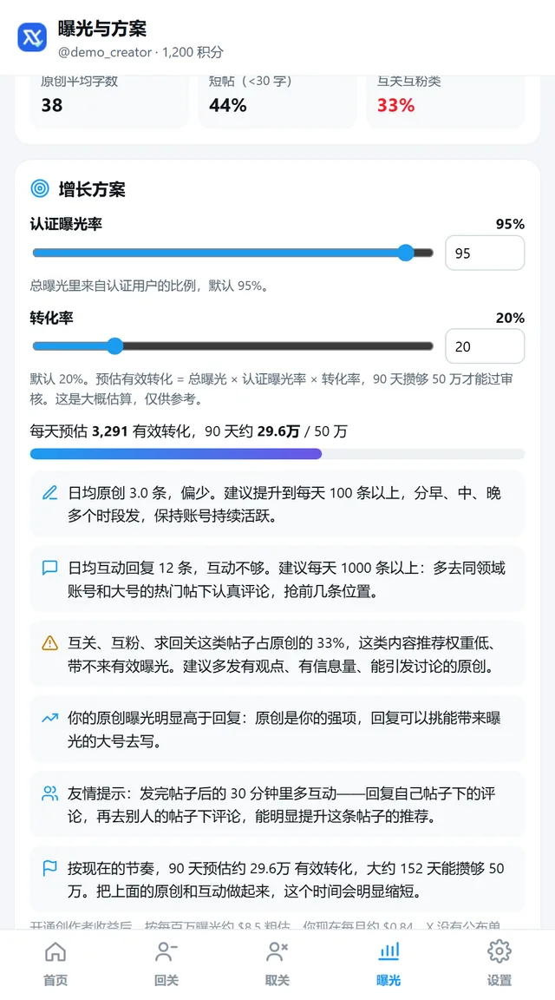
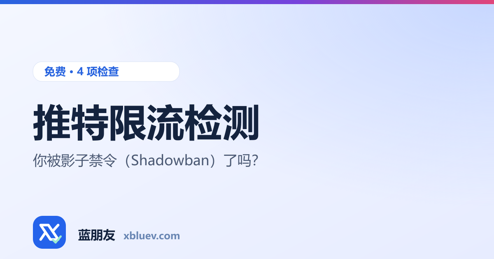
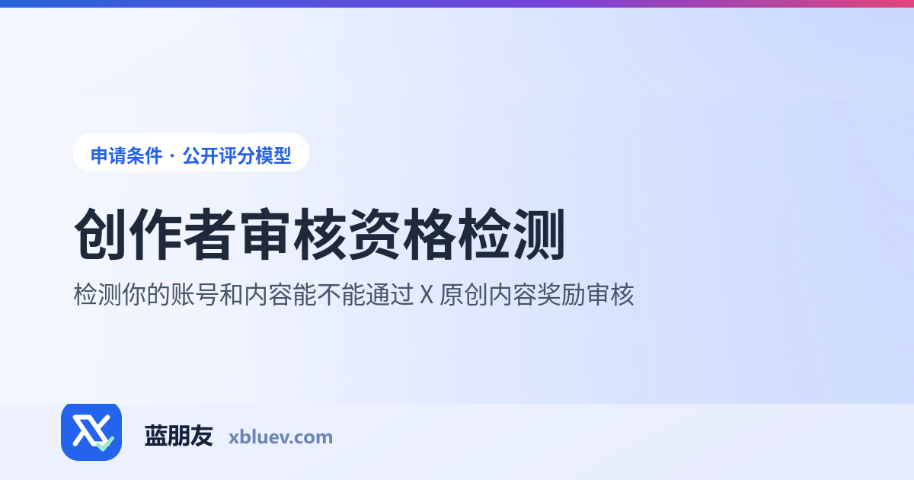
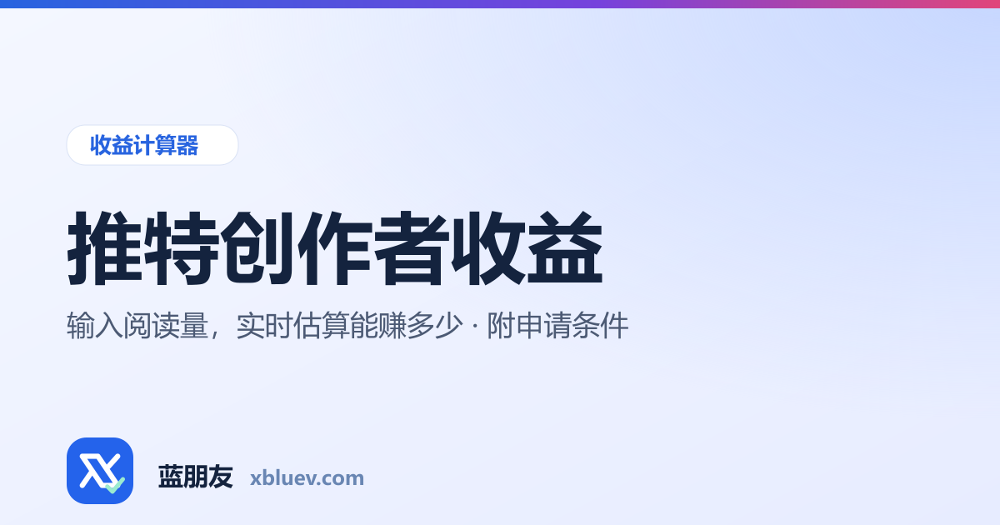
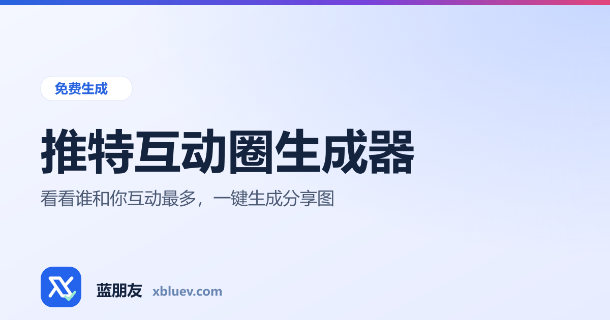
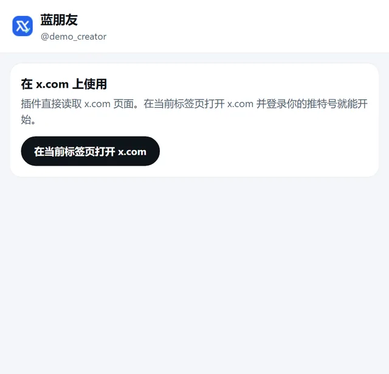

# 蓝朋友 XBlueV · 推特数据助手

  

**蓝朋友（XBlueV）** 是面向 X（Twitter / 推特）创作者和运营者的浏览器插件与在线工具箱。在 `x.com` 旁边打开像手机 App 一样的侧边栏，就能做 **谁没回关我**（推特回关检测、单向关注查询）、**谁取关了我**（推特取关查询）、**近 3 天曝光与涨粉方案**，并在插件里直达官网的 **限流检测**、**影子限流检测（Shadowban / 影子禁令）**、**创作者审核资格检测**、**推特曝光收益计算器**、**流量密码**（热点与爆款推文）等工具。

- 官网与完整介绍：[xbluev.com](https://xbluev.com) · 插件页：[中文](https://xbluev.com/zh/extension) / [English](https://xbluev.com/en/extension)
- Chrome 应用店（推荐安装）：[蓝朋友 XBlueV · 推特数据助手](https://chromewebstore.google.com/detail/lcecbkppdjojmblmmkphoifapginnagc)
- 官方账号：[@xbluev](https://x.com/xbluev)

首次登录送 **300 积分**，插件和网站功能都能用。插件不读取你的 X 密码，也不会替你关注、取关、点赞或发帖。名单和记录默认保存在你自己的浏览器里。下面截图为插件真实界面，使用的是示例数据。

  
  
  
  

## 功能一览

| 功能 | 能做什么 | 入口 |
| --- | --- | --- |
| 谁没回关我 / 推特回关检测 / 单向关注查询 | 一键读完关注列表，找出你关注了但没有回关你的人，可在 x.com 关注页标红 | 插件「回关」页，或 [网站工具](https://xbluev.com/zh/fans) |
| 谁取关了我 / 推特取关查询 | 对比粉丝变化，列出谁取关、谁新关注，支持历史记录、导出和分享图 | 插件「取关」页，或 [每日取关统计](https://xbluev.com/zh/fans/unfollowers) |
| 曝光与方案 / 近 3 天曝光 / 涨粉方案 | 统计近 3 天曝光、原创和回复，估算离创作者收益 50 万认证曝光还差多少，并给出每天该多发几条 | 插件「曝光」页 |
| 限流检测 / 影子限流检测 / Shadowban 影子禁令检测 | 4 项直接检查：搜索建议、搜索结果、回复可见性、回复排序，附证据和可见度分数 | 插件内打开，或 [限流检测](https://xbluev.com/zh/limit-check) |
| 创作者审核资格检测 / 创作者收益资格审核 | 对照 Premium、500 认证粉丝、90 天 50 万认证曝光等申请条件，评估内容能否通过原创内容奖励审核 | 插件内打开，或 [资格审核检测](https://xbluev.com/zh/eligibility-check) |
| 推特曝光收益计算器 / 一万阅读能赚多少钱 | 按曝光量、认证读者占比和公开自述单价，估算每月收益和达标进度 | 插件内打开，或 [收益计算器](https://xbluev.com/zh/earnings-calculator) |
| 流量密码 / 热点 / 爆款推文 | 查看蓝朋友采集的热议话题和爆款推文，可去网站改写或学习写法 | 插件「流量密码」 |
| 主页实时数据 / 今天发了多少帖 | 在任何人的主页看实时粉丝、是否关注你、回关可能性，并统计对方今天的原创和回复 | 打开任意 x.com 主页 |
| 导出 CSV / 分享图 / 一键发推 | 名单可搜索、筛选、排序、分页，导出 CSV，生成分享图并一键发推 | 各名单页 |
| 推特互动圈生成 | 把最近真正和你互动的人画成一张可分享的图 | [互动圈生成器](https://xbluev.com/zh/fans/circle) |

## 谁没回关我（推特回关检测 / 单向关注查询）

「谁没回关我」用来做 **推特回关检测** 和 **单向关注查询**：一键读取你在 X（Twitter）上的关注列表，找出你关注了、但没有回关你的人。插件直接读取你打开的 `x.com`，不扣积分，也不用一页页往下翻。读完后可以：

- 按名字或用户名搜索，按全部 / 认证 / 未认证筛选，排序后导出 CSV，或复制用户名
- 在 x.com 的关注页把没回关的人标红，也可以淡化已经互关的人，清理关注列表更直观
- 把结果生成分享图，或一键发推

同一功能也可以在官网使用：[谁没回关我 · 推特回关检测](https://xbluev.com/zh/fans)。大号也能扫描，结果可搜索、排序和导出，方便清理单向关注。

## 谁取关了我（推特取关查询）

「谁取关了我」是 **推特取关查询** 工具。插件通过蓝朋友网站接口读取你的粉丝名单（按量扣积分，需要登录，不占用你推特账号的额度），和上一次保存的名单对比，立刻看出这段时间谁取关了你、谁新关注了你。名单里能看到对方粉丝数，以及你是否还在关注对方。

- 保留最近多次历史记录，方便回头看变化
- 支持搜索、认证筛选、导出 CSV、复制用户名、生成分享图和一键发推
- 粉丝特别多的账号，也可以改用官网的 [谁取关了我 · 每日取关统计](https://xbluev.com/zh/fans/unfollowers)：免费订阅后每天对比互关好友，结果会逐个核实，可导出名单、生成分享图；也可以随时手动对比

插件不会替你回取关。要不要取关对方由你自己决定；短时间大量取关可能被 X 视为自动化行为，建议慢慢处理。

## 曝光与方案（近 3 天曝光、涨粉方案、创作者收益门槛）

「曝光与方案」统计你近 3 天每天的曝光、原创和回复，并给出可执行的 **涨粉方案**。它会按你设定的认证曝光率和转化率，估算离 X **创作者收益（原创内容奖励）** 申请条件里的 **90 天 50 万认证曝光** 还差多少，以及按当前节奏大概还要多少天。

你还可以看到原创平均字数、短帖占比、互关互粉类帖子占比，以及针对发帖量、互动回复、内容类型的具体建议。这一页直接读取 `x.com`，不扣积分。

如果你已经在冲创作者收益，可同时搭配下面的 **创作者审核资格检测** 和 **推特曝光收益计算器**，先看内容风控和收益估算。

## 限流检测 / 影子限流检测（Shadowban / 影子禁令）

帖子突然没曝光、搜索找不到、回复石沉大海，很多人第一反应就是自己被 **限流** 或 **影子限流（Shadowban / 影子禁令 / 幽灵封禁）** 了。蓝朋友提供免费的 **推特限流检测** 和 **影子限流检测**：登录官网即可使用，不消耗积分，只使用公开数据，**不需要推特密码**。

一次检测包含 4 项直接检查，看 X 如何向别人展示你的账号：

1. **搜索建议**：用你的用户名在 X 用户搜索中精确查找，能不能搜到你
2. **搜索结果**：你最近的原创帖子能不能在搜索里被找到（搜索限制 / Search ban）
3. **回复可见性**：你在别人帖子下的回复，会不会在时间顺序的对话里消失（回复隐藏 / 幽灵封禁 / Ghost ban）
4. **回复排序**：回复在时间顺序里还在，却在默认「相关度」视图里消失（回复降权 / Reply deboosting）

结果会给出可见度分数、置信度，以及检查了哪些帖子和回复的证据，并标注检测时间。搜索里看不到不一定等于被平台处罚；私密账号、没有样本或接口出错时，会标为「无法判断」，而不是猜一个结果。同一账号 6 小时内复查会直接返回缓存结果。

另外还可以选购专项优化报告（积分消耗，失败自动退还）：审核近 30 天帖子与回复，列出可能的风险内容、最可能的原因，以及分步行动计划。

在插件首页的工具入口即可打开，也可以直接使用：[推特限流检测 / 影子限流检测](https://xbluev.com/zh/limit-check)。

## 创作者审核资格检测（创作者收益资格审核）

X 的 **原创内容奖励（Creator Revenue / 创作者收益）** 申请，通常需要同时满足：

- 订阅 **Premium**、Premium+ 或 Premium Business
- **500 名认证粉丝**（关注你的人本身也是认证用户）
- **90 天 50 万次认证曝光**（来自认证用户的首页时间线曝光，回复不计入）
- 年满 18 岁、所在地区支持、账号状态良好，并且持续发布原创内容

蓝朋友的 **创作者审核资格检测 / 创作者收益资格审核检测** 会对照这些申请条件，再根据公开数据评估你的账号和近期内容能不能通过审核。通过概率由蓝朋友自己的模型估算，**不代表 X 的真实审核结果**。报告可保存在「我的资料」，支持预览、下载和分享。

页面上还公开了评分模型和常见未通过原因，例如：违反创作者盈利标准、擦边或敏感内容、重复使用或搬运内容、非真实互动、违规或限流记录、互关互粉、刷量或诱导互动、自动化 / AI 批量、模板化内容、帖子普遍偏短等。你也可以查看创作者本人公开分享的通过 / 未通过案例。

在插件的曝光页或工具入口即可打开，也可以直接使用：[创作者收益资格审核检测](https://xbluev.com/zh/eligibility-check)。

## 推特曝光收益计算器（一万阅读能赚多少钱）

**推特曝光收益计算器** 用来估算：你的阅读量大概能换来多少创作者收益，以及「推特一千、一万、一百万阅读能赚多少钱」。输入每月曝光量（阅读量），再调整认证（Premium）读者占比和收益水平，就能实时看到预计每月收益、每 14 天结算金额，以及 90 天合格曝光离 50 万申请门槛还差多少；也可以反过来填目标金额，反推需要多少曝光。

计算时请记住：

- 只有「合格曝光」才算钱：原创帖子在 **首页时间线** 被 **Premium 订阅用户** 看到（帖子至少一半出现在屏幕上），同一个人只算一次；**回复不计入**
- 别人从你的主页、搜索、通知或直接打开链接看到的，按规则不计入
- X 没有公布官方单价。计算器里的单价来自创作者公开自述的区间：每 100 万总曝光约 $3–$15，最常被引用的是 $8.5，属于**预估值**，不是承诺
- 认证读者占比越高，同样的阅读量收益通常越高；实际数字以 Creator Studio 为准

在插件里即可打开，也可以直接使用：[推特创作者收益计算器](https://xbluev.com/zh/earnings-calculator)。

## 流量密码、主页数据，以及导出分享

插件里的 **流量密码** 会展示蓝朋友每天采集的热点、热议词云、X 实时趋势和爆款推文。看到合适的话题，可以去官网「改写这条帖」用自己的观点写原创，或「蒸馏 X」学习作者写法。相关页面：[正在热议的话题](https://xbluev.com/zh/trends)、[爆款推文](https://xbluev.com/zh/viral)、[热点转原创](https://xbluev.com/zh/trend-to-original)。

打开任何人的 X 主页时，插件还可以显示：

- **主页实时数据**：实时粉丝数、对方是否关注了你、回关可能性
- **今天发了多少帖**：一键统计对方今天的原创和回复数量

各名单页都支持搜索、筛选、排序、分页，一键 **导出 CSV**，把统计结果做成 **分享图**，并 **一键发推**。

如果你想看看谁才是真正经常和你互动的人，可以用官网免费的 [推特互动圈生成器](https://xbluev.com/zh/fans/circle)：分析最近的回复、转发和提及，生成可下载、可分享的互动圈图片。

## 登录、积分与会员

在插件里登录蓝朋友账号后，首次登录赠送 **300 积分**，可以用于「谁取关了我」等按量计费的网站能力，也可以每天领取积分、查看会员状态。部分功能（谁没回关我、曝光与方案）直接读 `x.com`，不扣积分；「谁取关了我」、限流检测报告、创作者审核资格检测等会走蓝朋友网站，按说明扣积分或按套餐次数使用。

登录过程不需要你的推特密码。可在设置里切换中文 / English，插件默认跟随浏览器语言。

## 安装

### 方式一：Chrome 网上应用店（推荐）

直接从 [Chrome 网上应用店安装「蓝朋友 XBlueV · 推特数据助手」](https://chromewebstore.google.com/detail/lcecbkppdjojmblmmkphoifapginnagc)。Microsoft Edge 也可以打开同一商店页面安装。安装后打开 [x.com](https://x.com)，点击工具栏图标即可打开侧边栏。更完整的图文说明见 [官网插件页](https://xbluev.com/zh/extension)。

### 方式二：加载本仓库源码（开发版）

1. 克隆本仓库
2. 打开 Chrome / Edge 的 `chrome://extensions`（Edge 为 `edge://extensions`），打开「开发者模式」
3. 点击「加载已解压的扩展程序」，选择本仓库目录（能看到 `manifest.json` 的那一层）
4. 打开 [x.com](https://x.com) 并登录你的推特号，点击工具栏上的蓝朋友图标，在右侧打开侧边栏

建议把插件固定到工具栏，之后打开 x.com 就能随时使用。

## 支持哪些浏览器

| 浏览器 | 支持情况 | 说明 |
| --- | --- | --- |
| Google Chrome | 完整支持（推荐） | 需要 114 或更新版本 |
| Microsoft Edge | 完整支持（推荐） | 需要 114 或更新版本 |
| Brave、Vivaldi、Opera、360 极速浏览器等 Chromium 内核浏览器 | 可以安装，侧边栏取决于浏览器 | 浏览器要支持扩展侧边栏；点图标没反应请改用 Chrome 或 Edge |
| Firefox / Safari | 暂不支持 | 插件基于 Chrome 扩展标准（Manifest V3 + 侧边栏） |
| 手机浏览器 | 不支持 | 请在电脑上使用；手机上可直接用 [蓝朋友官网](https://xbluev.com) 的谁没回关我、谁取关了我、限流检测等工具 |

## 隐私与安全

- 不需要、也不会向你索取 X（Twitter）密码
- 不会替你关注、取关、点赞、回复或发帖
- 「谁没回关我」「曝光与方案」直接读取你已打开的 x.com 页面数据
- 「谁取关了我」会把你的推特用户名发给蓝朋友网站，由网站读取粉丝名单后返回；对比和保存默认在你自己的浏览器里完成
- 读到的名单、取关记录和曝光数据默认只存在当前浏览器，换电脑或换浏览器后需要重新读取；需要备份可以导出 CSV
- 限流检测、资格审核、收益计算等网站工具只使用公开数据，结果为观察值或估算，不代表 X 官方处罚或官方收益

## 配置

`config.js` 里的网站地址是 [https://xbluev.com](https://xbluev.com)，用于登录、分享和接口。一般不需要改。

## 相关链接

- 官网：[https://xbluev.com](https://xbluev.com)
- 插件介绍与安装教程：[https://xbluev.com/zh/extension](https://xbluev.com/zh/extension)
- Chrome 网上应用店：[蓝朋友 XBlueV · 推特数据助手](https://chromewebstore.google.com/detail/lcecbkppdjojmblmmkphoifapginnagc)
- [限流检测 / 影子限流检测](https://xbluev.com/zh/limit-check)
- [创作者审核资格检测](https://xbluev.com/zh/eligibility-check)
- [推特曝光收益计算器](https://xbluev.com/zh/earnings-calculator)
- [谁没回关我](https://xbluev.com/zh/fans) · [谁取关了我](https://xbluev.com/zh/fans/unfollowers) · [互动圈生成](https://xbluev.com/zh/fans/circle)
- 官方 X 账号：[@xbluev](https://x.com/xbluev)

## 许可

MIT
